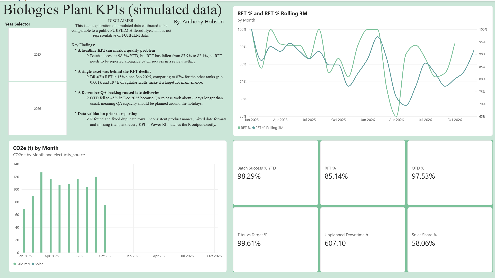
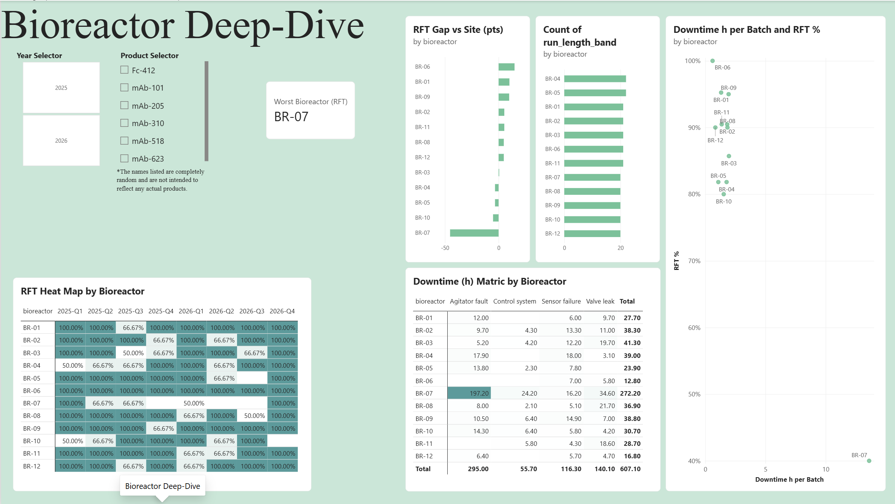

# Biologics Plant KPI Dashboard

A KPI dashboard for a simulated 12 × 20,000 L biologics plant, built with **R → Power Query → DAX → Power BI**.

> **About the data:** The data is simulated. It was generated using Claude Opus 5.5 and calibrated to be comparable to the public headline figures in a FUJIFILM Diosynth Biotechnologies Hillerød flyer: 12 × 20,000 L bioreactors, about 98.5% batch success YTD, and 100% solar electricity from October 2025. None of the figures are FUJIFILM's.




## Key findings

**A headline KPI can mask a quality problem**
Batch success is 98.3% YTD, but RFT has fallen from 87.9% to 82.1%, so RFT needs to be reported alongside batch success in a review setting.

**A single asset was behind the RFT decline**
BR-07’s RFT is 15% since Sep 2025, comparing to 87% for the other tanks (p < 0.001), and 197 h of agitator faults make it a target for maintenance.

**A December QA backlog causes late deliveries**
OTD fell to 45% in Dec 2025 because QA release took about 6 days longer than usual, meaning QA capacity should be planned around the holidays.

**Data validation prior to reporting**
R found and fixed duplicate rows, inconsistent product names, mixed date formats and missing titers, and every KPI in Power BI matches the R output exactly.

## KPI definitions

| KPI | Definition |
|---|---|
| Batch success % | Batches not rejected ÷ all batches |
| Right first time % | Released with 0 deviations ÷ all batches |
| Titer vs target | Actual titer ÷ target titer, averaged (missing titers excluded) |
| On-time delivery % | Delivered on or before the promised date ÷ delivered batches |
| Unplanned downtime (h) | Hours of unplanned equipment stops |
| Solar share / CO2e | Solar kWh ÷ total kWh; grid kWh × 0.12 kg CO2e/kWh (assumed), solar = 0 |

## Method

1. **R (tidyverse):** removes duplicates, parses mixed date formats, standardises product names, flags missing values, calculates the KPI fields, writes a data-quality log and a reconciliation, and runs a significance test. → `R/clean_and_kpis.R`
2. **Power Query (M):** a folder parameter, explicit column types with a locale, custom and conditional columns, a Group By summary, and a calendar table. → `powerquery/*.m`
3. **DAX:** KPI measures, time intelligence (YTD, prior year, rolling 3 months), comparison with the site average using `ALL`, and a worst-bioreactor measure using `TOPN`. → `powerquery/measures.dax`
4. **Power BI:** a star schema (Date and Bioreactor dimensions, batch and downtime facts) and three pages: site overview, bioreactor deep-dive, and definitions & data quality, including the R vs Power BI reconciliation.

## Limitations

- Only the plant's size and headline figures come from a public source.
- BR-07 only has 13 batches since Sep 2025, and the comparison was chosen after exploring the data.
- The December QA effect is seen in only one December (2025).
- The CO2e factor, run times, and turnaround times are assumptions based on independent research.

## Repository contents

```
data/raw/            raw CSVs, with data-quality issues planted in them
data/clean/          cleaned CSVs written by R
R/                   cleaning and KPI script
powerquery/          M queries and DAX measures
dashboard/           .pbix file and PDF export
screenshots/         dashboard images
```

*Built by Anthony Hobson, November 2026*
*Claude Opus 5.5 used for data generation*
